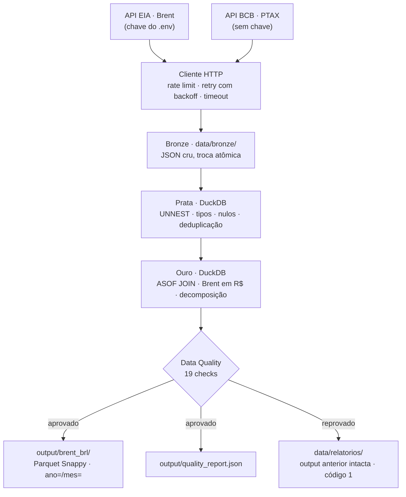

# brent-brl-pipeline

**Quanto custa, em reais, o barril de petróleo, e por que esse custo mudou hoje?**

Pipeline de dados em Python + SQL (DuckDB) que cruza o preço internacional do petróleo Brent (API da EIA, EUA) com a cotação oficial do dólar (PTAX, API do Banco Central do Brasil) e entrega, todo dia, o custo do barril em reais **decomposto em efeito do petróleo e efeito do câmbio**, com validações automáticas de qualidade e relatório de auditoria.

> Desafio Python – FT03 – Projeto 1 (Fast Track). Autor: Alex Lourenço.

---

## Sumário

1. [Objetivo de negócio](#1-objetivo-de-negócio)
2. [Como executar](#2-como-executar)
3. [Variáveis de ambiente](#3-variáveis-de-ambiente)
4. [As APIs e como elas se relacionam](#4-as-apis-e-como-elas-se-relacionam)
5. [Arquitetura](#5-arquitetura)
6. [Transformações](#6-transformações)
7. [Data Quality](#7-data-quality)
8. [Saída: o produto de dados](#8-saída-o-produto-de-dados)
9. [Resiliência e segurança](#9-resiliência-e-segurança)
10. [Testes](#10-testes)
11. [Estrutura do repositório](#11-estrutura-do-repositório)
12. [Decisões e limitações](#12-decisões-e-limitações)
13. [Requisitos do desafio → onde estão](#13-requisitos-do-desafio--onde-estão)
14. [Próximo passo: migração para o Databricks](#14-próximo-passo-migração-para-o-databricks)

---

## 1. Objetivo de negócio

**O problema.** Quem compra ou planeja custos de petróleo no Brasil acompanha duas séries que vêm de lugares diferentes: o preço do barril, cotado em **dólares** em Londres, e o **dólar** em reais, publicado pelo Banco Central. Hoje essas séries costumam ser juntadas à mão, e o número final em reais esconde o que realmente aconteceu no dia.

**O que o pipeline entrega.** Uma tabela diária, pronta para análise (Power BI, Excel, SQL), com:

- o **barril em reais** (`brent_brl = brent_usd × ptax_venda`);
- a **variação** em relação ao pregão anterior;
- a **decomposição** dessa variação em **efeito preço** (o petróleo mudou) e **efeito câmbio** (o dólar mudou).

**Por que a decomposição importa.** Um custo estável em reais pode esconder dois movimentos fortes que se anularam. Exemplo real do dataset, **05/06/2026**: o petróleo derrubou o custo em R$ 8,52 por barril e o dólar o empurrou para cima em R$ 8,07; a variação total foi de apenas −R$ 0,45. Olhando só o valor em reais, o dia parece calmo; com a decomposição, fica claro que o custo só não caiu porque o dólar subiu.

**Para quem.** Áreas de planejamento, suprimentos e análise de mercado que precisam explicar a variação do custo do petróleo em reais.

---

## 2. Como executar

### Pré-requisitos

- **Python 3.11+**
- **Git** (no Windows, o `run.sh` roda pelo **Git Bash**, que vem junto com o Git)
- Uma **chave gratuita da EIA**: cadastro em <https://www.eia.gov/opendata/register.php> (a chave chega por e-mail)

### Passo a passo (comando único)

```bash
git clone https://github.com/alexlourenc/brent-brl-pipeline.git
cd brent-brl-pipeline
cp .env.example .env        # depois, edite o .env e preencha a EIA_API_KEY
./run.sh
```

O `run.sh` faz tudo, nesta ordem:

1. cria o ambiente virtual `.venv` (na primeira execução);
2. instala as dependências com versões fixadas (`requirements.txt`);
3. confere se o `.env` existe;
4. roda os **38 testes automáticos** (se algum falhar, para aqui);
5. roda o **pipeline completo** (extração → bronze → prata → ouro → qualidade → saída).

O código de saída do script é **0** em caso de sucesso e **1** em caso de falha.

### Outras formas de executar

```bash
./run.sh --sem-extracao          # reprocessa a partir da bronze existente, sem chamar as APIs
python -m pipeline               # o pipeline direto (com a .venv ativa)
python -m pipeline --verificar-config   # só valida o .env e mostra a configuração
python -m pytest -v              # só os testes
```

**Sem bash (PowerShell):** com a `.venv` ativa, `pip install -r requirements.txt` e depois `python -m pipeline`.

---

## 3. Variáveis de ambiente

Todas ficam no arquivo `.env` (que **nunca** vai para o Git). O modelo está em `.env.example`.

| Variável | Obrigatória | Padrão | Descrição |
| --- | --- | --- | --- |
| `EIA_API_KEY` | **Sim** | – | Chave da API da EIA. Sem ela, o pipeline para logo no início com uma mensagem clara. |
| `DATA_INICIO` | Não | `2024-01-01` | Início do período (AAAA-MM-DD). |
| `DATA_FIM` | Não | hoje | Fim do período (AAAA-MM-DD). Vazio = até hoje. |
| `LOG_LEVEL` | Não | `INFO` | Detalhe do log: `DEBUG`, `INFO`, `WARNING`. |
| `HTTP_MAX_TENTATIVAS` | Não | `4` | Total de tentativas por chamada (1 original + retentativas). |
| `HTTP_BACKOFF_BASE_S` | Não | `1.0` | Base do backoff exponencial: esperas de 1s, 2s, 4s... |
| `HTTP_INTERVALO_MIN_S` | Não | `1.0` | Intervalo mínimo entre chamadas à mesma API (rate limit). |
| `HTTP_TIMEOUT_S` | Não | `30` | Tempo máximo de espera por uma resposta. |

---

## 4. As APIs e como elas se relacionam

| | EIA Open Data v2 | BCB Olinda – PTAX |
| --- | --- | --- |
| **Domínio** | Energia | Câmbio |
| **O que traz** | Preço spot do petróleo Brent (série `RBRTE`) | Cotação do dólar, de compra e de venda |
| **Unidade** | US$ por barril | R$ por US$ |
| **Frequência** | Diária (dias de negociação em Londres) | Diária (dias úteis no Brasil) |
| **Endpoint** | `https://api.eia.gov/v2/petroleum/pri/spt/data/` | `https://olinda.bcb.gov.br/olinda/servico/PTAX/versao/v1/odata/CotacaoDolarPeriodo(...)` |
| **Autenticação** | Chave (`api_key`), lida do `.env` | Nenhuma |
| **Onde está a lista no JSON** | `response.data` (2 níveis) | `value` (1 nível) |
| **Particularidades** | O valor vem como **texto** (`"77.18"`); máximo de 5.000 linhas por chamada (paginação por `offset`) | Datas no formato `'MM-DD-AAAA'` com aspas; data **e hora** da cotação |
| **Documentação** | <https://www.eia.gov/opendata/documentation.php> | <https://dadosabertos.bcb.gov.br/> |

**Como se relacionam:** a EIA diz quanto custa o barril em **dólares**; o BCB diz quanto custa o **dólar** em reais. O cruzamento é pela **data**. Como os calendários são diferentes (feriados em Londres × feriados no Brasil), o pipeline usa, para cada dia de Brent, a **última PTAX publicada até aquela data** (ver [seção 12](#12-decisões-e-limitações)).

**Por que a PTAX de venda:** é a taxa pela qual os bancos vendem dólar. Quem importa petróleo precisa **comprar** dólares para pagar, e paga essa taxa.

---

## 5. Arquitetura

Arquitetura em camadas (medalhão), com DuckDB como motor SQL:



| Camada | Onde fica | Conteúdo | No Git? |
| --- | --- | --- | --- |
| Bronze | `data/bronze/` | JSON exatamente como veio da API, um arquivo por ano (e por página, na EIA) | Não (regenerável) |
| Prata | `data/prata/` + memória | Uma tabela limpa por fonte, uma linha por dia | Não (regenerável) |
| Ouro | `output/brent_brl/` | O produto de dados final, particionado | **Sim** (entregável) |

---

## 6. Transformações

Todo o SQL fica em arquivos próprios, em `src/pipeline/sql/` (o Python orquestra, o SQL transforma).

| # | Transformação obrigatória | Como é feita | Onde |
| --- | --- | --- | --- |
| — | **Desaninhamento** | `UNNEST(value, recursive := true)` e `UNNEST(response.data, recursive := true)` | `silver_ptax.sql`, `silver_brent.sql` |
| 1 | **Padronização de tipos e datas** | `CAST`/`TRY_CAST`: texto → `DOUBLE`; data e hora → `DATE` | pratas |
| 2 | **Tratamento de nulos** | Valores vazios viram `NULL` (`TRY_CAST`) e são descartados; dias sem PTAX recebem a última cotação válida, marcados em `ptax_preenchida` | pratas e ouro |
| 3 | **Deduplicação** | `ROW_NUMBER() OVER (PARTITION BY data ORDER BY data_hora_cotacao DESC)`, mantendo a cotação mais recente do dia | `silver_ptax.sql`, `silver_brent.sql` |
| 4 | **Cruzamento de fontes** | `ASOF LEFT JOIN`: cada dia de Brent recebe a PTAX mais recente até aquela data | `gold_brent_brl.sql` |
| 5 | **Enriquecimento de métricas** | Brent em R$, variação (R$ e %), efeito preço, efeito câmbio, média móvel de 7 pregões, spread da PTAX | `gold_brent_brl.sql` |

---

## 7. Data Quality

São 19 checks automáticos, que rodam sobre as tabelas **antes** de qualquer gravação na `output/`. Eles têm dois níveis de severidade:

- **Bloqueante:** o dado está **errado**. Se qualquer um falhar, a `output/` anterior é mantida e o pipeline termina com código 1.
- **Alerta:** o dado está **estranho** e merece análise, mas pode ser verdadeiro. Ele aparece no relatório e não bloqueia a entrega.

| Tipo | Qtd. | Exemplos |
| --- | --- | --- |
| Schema | 3 | Colunas e tipos de cada tabela conferidos contra um contrato |
| Null ratio | 5 | `brent_brl` sem nulos; `variacao_brl` nula só na 1ª linha |
| Unicidade | 3 | Uma linha por `data` em cada tabela |
| Intervalo | 6 | Brent entre 10 e 200 US$; PTAX entre 1 e 15 R$; datas dentro do período |
| Regra de negócio | 1 | Efeito preço + efeito câmbio = variação total |
| Anomalia (alerta) | 2 | Variação diária acima de 10%; mais de 5% de dias com PTAX emprestada |

**Relatório:** `output/quality_report.json`, com:

- `status_geral` (`aprovado`, `aprovado_com_alertas` ou `reprovado`);
- tempos da execução e período;
- chamadas, retentativas e falhas por API;
- **volumes por camada**, por exemplo: PTAX 727 → 726, com a perda de uma duplicata real do BCB em 23/04/2025; Brent 729 → 729 → 729;
- cada check com o valor medido.

---

## 8. Saída: o produto de dados

`output/brent_brl/ano=AAAA/mes=M/*.parquet`, em formato colunar, com compressão **Snappy** e particionamento por **ano e mês** (estilo Hive). Uma linha por dia de negociação do Brent.

### Dicionário de dados

| Coluna | Tipo | Unidade | Descrição |
| --- | --- | --- | --- |
| `data` | DATE | – | Dia de negociação do Brent |
| `ano`, `mes` | BIGINT | – | Colunas de partição |
| `brent_usd` | DOUBLE | US$/barril | Preço do Brent (EIA) |
| `ptax_compra` | DOUBLE | R$/US$ | PTAX de compra (BCB) |
| `ptax_venda` | DOUBLE | R$/US$ | PTAX de venda (BCB), **usada na conversão** |
| `spread_ptax` | DOUBLE | R$/US$ | `ptax_venda − ptax_compra` |
| **`brent_brl`** | DOUBLE | **R$/barril** | **`brent_usd × ptax_venda`** |
| `variacao_brl` | DOUBLE | R$/barril | Variação em relação ao pregão anterior |
| `variacao_brl_pct` | DOUBLE | % | A mesma variação, em percentual |
| `efeito_preco_brl` | DOUBLE | R$/barril | Parte da variação causada pelo petróleo: `(Brentₜ − Brentₜ₋₁) × PTAXₜ₋₁` |
| `efeito_cambio_brl` | DOUBLE | R$/barril | Parte da variação causada pelo dólar: `Brentₜ × (PTAXₜ − PTAXₜ₋₁)` |
| `media_movel_7_pregoes_brl` | DOUBLE | R$/barril | Média dos últimos 7 pregões |
| `ptax_preenchida` | BOOLEAN | – | `true` = dia sem PTAX (feriado no Brasil), cotação do dia útil anterior |
| `data_ptax_usada` | DATE | – | De qual dia veio a PTAX usada |

A soma `efeito_preco_brl + efeito_cambio_brl` é **exatamente** a `variacao_brl` (diferenças só na 4ª casa, por arredondamento).

### Como ler

```python
import duckdb
duckdb.sql("""
    SELECT data, brent_usd, ptax_venda, brent_brl, efeito_preco_brl, efeito_cambio_brl
    FROM read_parquet('output/brent_brl/**/*.parquet', hive_partitioning = true)
    ORDER BY data DESC
    LIMIT 10
""").show()
```

No Power BI ou no pandas, basta apontar para a pasta `output/brent_brl/`.

---

## 9. Resiliência e segurança

| Situação | Comportamento |
| --- | --- |
| Erro temporário (429, 5xx, timeout, sem conexão) | Retentativa com **backoff exponencial** (1s, 2s, 4s); respeita o `Retry-After` |
| Erro definitivo (400, 401, 403, 404) | Falha **na hora**, sem retentar, com mensagem clara |
| Retentativas esgotadas | Falha visível; o pipeline termina com código 1 |
| Excesso de chamadas | **Rate limit**: intervalo mínimo de 1s entre chamadas à mesma API |
| Falha no meio da extração | **Troca atômica**: o download vai para uma pasta temporária, e a bronze anterior só é substituída se tudo der certo |
| Resposta com formato inesperado | Validada **antes** de gravar; não chega à bronze |
| Check bloqueante falhou | A `output/` anterior fica intacta; o relatório da falha vai para `data/relatorios/` |
| Volume grande na EIA | Paginação por `offset` até o `total` anunciado; período fatiado em blocos anuais |

**Credencial (defesa em camadas):**

- o `.env` está no `.gitignore`;
- a configuração nunca imprime a chave e mostra só `****` + 4 caracteres;
- os erros de conexão registram só o **tipo** do erro, porque a mensagem completa traz a URL com a chave;
- um teste automático garante que a chave não é gravada na bronze.

---

## 10. Testes

```bash
python -m pytest -v      # 38 testes, ~2 segundos, sem internet
```

Os testes não dependem das APIs. A entrada é uma bronze de exemplo pequena, com os casos difíceis montados de propósito (PTAX duplicada, feriado sem PTAX, Brent vazio), e as chamadas HTTP são substituídas por respostas falsas (*mocks*).

| Arquivo | O que prova |
| --- | --- |
| `test_http_client.py` | Retry com backoff, erro definitivo sem retry, `Retry-After`, rate limit, chave fora do log |
| `test_config.py` | Fail fast: sem chave, data inválida, parâmetro inválido; chave escondida |
| `test_extracao.py` | Troca atômica, validação do JSON, paginação, chave fora da bronze |
| `test_transformacao.py` | Deduplicação, tipos, ASOF no feriado, conversão, decomposição, Parquet particionado |
| `test_qualidade.py` | Dado bom passa; duplicata, negativo, nulo, coluna faltando e tabela vazia são pegos |
| `test_pipeline.py` | Aprovado → código 0; reprovado → código 1 e `output/` intocada; API fora do ar → código 1 |
| `test_periodos.py` | Blocos anuais sem sobreposição nem buraco |

---

## 11. Estrutura do repositório

```text
brent-brl-pipeline/
├── run.sh                    # execução ponta a ponta (comando único)
├── requirements.txt          # dependências com versões fixadas
├── pyproject.toml            # pacote instalável (src/) e configuração do pytest
├── .env.example              # modelo das variáveis de ambiente (sem segredos)
├── docs/HISTORICO.md         # histórico de alterações
├── src/pipeline/
│   ├── __main__.py           # orquestração: python -m pipeline
│   ├── config.py             # leitura e validação do .env
│   ├── extract/              # http_client, bcb, eia, periodos, armazenamento
│   ├── sql/                  # silver_ptax, silver_brent, gold_brent_brl
│   ├── transform/            # duckdb_runner: executa os .sql
│   ├── quality/              # checks e relatório
│   └── load/                 # writer: Parquet particionado
├── tests/                    # 38 testes (pytest), sem internet
├── data/                     # bronze e prata (fora do Git, regeneráveis)
└── output/                   # produto final + quality_report.json (versionado)
```

---

## 12. Decisões e limitações

- **Base do cruzamento é o Brent.** Dias sem Brent (feriados em Londres) ficam de fora, porque não há o que converter.
- **Feriados brasileiros usam a última PTAX publicada** (`ASOF JOIN`), marcados em `ptax_preenchida`. A interpolação pelos vizinhos foi descartada: usaria uma cotação **futura**, que não existia no dia (*look-ahead bias*), e criaria um valor que o Banco Central nunca publicou.
- **Limitação conhecida:** num feriado brasileiro, o `efeito_cambio_brl` é zero por construção, e o dia útil seguinte acumula dois dias de variação do dólar. Para analisar a decomposição, vale filtrar ou observar `ptax_preenchida` do dia e do pregão anterior.
- **Variação é em relação ao pregão anterior**, e não ao dia anterior do calendário: segunda-feira compara com sexta.
- **A EIA publica com alguns dias de atraso**, então o fim da série do Brent pode ser anterior ao `DATA_FIM`.
- **Ferramentas:** DuckDB no lugar de pandas/Spark. Resolve leitura de JSON, `UNNEST`, SQL e gravação de Parquet particionado numa ferramenta só, e o SQL migra quase sem mudança para Spark/Databricks.

---

## 13. Requisitos do desafio → onde estão

| Requisito | Implementação |
| --- | --- |
| 2 APIs de domínios distintos | `extract/eia.py` (energia) e `extract/bcb.py` (câmbio) |
| Rate limit, retentativas e tratamento de erros | `extract/http_client.py`, `extract/armazenamento.py` |
| Credenciais via variáveis de ambiente | `config.py`, `.env.example`, `.gitignore` |
| Código modular com type hints | `src/pipeline/` |
| Desaninhamento via SQL | `UNNEST` em `sql/silver_*.sql` |
| 5 transformações | [seção 6](#6-transformações) |
| Schema, null ratio, unicidade e intervalo | `quality/checks.py` |
| Relatório de qualidade (JSON) | `output/quality_report.json` |
| Parquet + Snappy + partição temporal | `load/writer.py` → `output/brent_brl/ano=/mes=/` |
| README, `requirements.txt`, execução única | Este arquivo, `requirements.txt`, `run.sh` |

## 14. Próximo passo: migração para o Databricks

O projeto foi organizado para migrar com pouca mudança: as camadas são as mesmas (bronze, prata, ouro), o SQL está separado do Python e os caminhos entram por marcadores (`{bronze}`).

| Hoje (local) | No Databricks |
| --- | --- |
| `.env` + `python-dotenv` | Secret scope: `dbutils.secrets.get("brent", "eia_api_key")` |
| `requests` + `http_client.py` | O mesmo código, num notebook ou job Python (confirmar que o workspace permite saída para a internet) |
| `data/bronze/` (JSON em disco) | Volume do Unity Catalog ou tabela Delta bronze |
| `read_json` + `UNNEST` (DuckDB) | `read_files(...)` / `spark.read.json` + `explode` / `inline` (Spark SQL) |
| `ROW_NUMBER`, `LAG`, janelas | Iguais no Spark SQL |
| `ASOF JOIN` | Não existe no Spark SQL: `JOIN` com `ptax.data <= brent.data` + `ROW_NUMBER` para ficar com a mais recente |
| Parquet + Snappy + `PARTITION_BY` | Tabela **Delta Lake** particionada por ano/mês (`overwrite` ou `MERGE`) |
| `quality/checks.py` | Os mesmos checks em PySpark, ou *expectations* num pipeline declarativo |
| `run.sh` + código de saída | **Workflow (Job)** com tarefas encadeadas: extração → prata → ouro → qualidade |
| Troca atômica de pastas | Transações ACID do Delta Lake (uma gravação que falha não deixa a tabela pela metade) |

---

*Desenvolvido por Alex Lourenço · Desafio Python FT03 – Projeto 1 · 2026*
